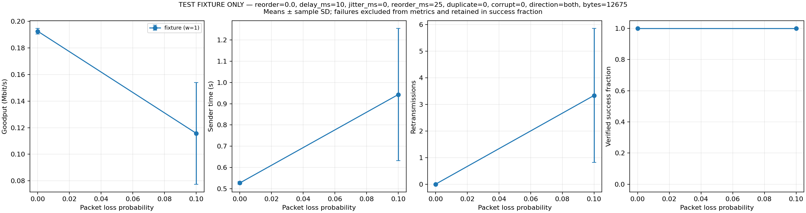
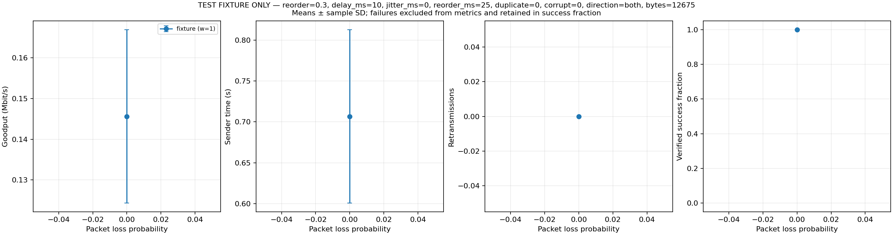

# Validation evidence

These are measured **test-fixture** results, not SW/GBN/SR performance results.
The sample roundtrip reconstructs output at the echo client and checks SHA-256;
the receiver side simply echoes datagrams. No protocol superiority is claimed.

## Local environment and checks

Windows, GCC 13.2.0 (MSYS2 UCRT64), C11, -O2, all of -Wall -Wextra
-Wpedantic -Werror, Winsock. Shell orchestration used MSYS2 Bash/GNU tools.

Executed successfully:

- make test: bounds/null/zero-payload/maximum-payload tests, certain loss,
  certain duplication/reordering/corruption, jitter clipping, seed replay,
  different-seed divergence, and 100,000-decision distribution checks.
- make integration: live two-way localhost UDP; clean traffic, certain DATA
  loss, certain duplication, certain corruption, constant delay, jitter,
  actual order inversion, queue overflow, and certain ACK loss.
- Live zero-byte and 65,507-byte IPv4 datagram roundtrips.
- Combined six-impairment 12,288-byte binary roundtrip: matching SHA-256 and
  six retransmissions for seed 2026 in the local verification run.
- tests/test_runner.sh: all nine seeded fixture cases, explicit missing-adapter
  failure, and refusal to overwrite an existing result directory.
- Five Python unittest cases for analysis, including hash/metric rejection,
  duplicate seed rejection, failed-run denominators, means/sample SD, and
  plotting a group containing only failed runs.

The GitHub Actions workflow independently runs Linux compilation, the full UDP
suite, ASan/UBSan builds, runner checks, and analysis tests. Consult the PR's
checks for the actual remote result; a workflow definition alone is not proof
that those checks passed.

## Retained sample data

The measured input is preserved as validation/fixture-input.bin (12,675 bytes),
SHA-256 c873768eb3dd9bd67c4afc11a5856dce1e9003d5e4a193d07d1f9af77258b508.
It is a fixed snapshot of the channel proxy source used as opaque test bytes.
The packet engine/proxy treats this file exactly like any binary payload.

Reproduce the experiment shape (timings will differ by machine):

    bash experiments/run_matrix.sh tests/fixture_matrix.csv \
      docs/validation/fixture-input.bin results/reproduction tests/adapters
    python analysis/plot_runs.py results/reproduction/runs.csv \
      --output results/reproduction/plots --x loss

The CSVs contain the original measured runs and aggregate statistics, including
all source/received hashes, three seeds per scenario, timing, and retransmits.
Every retained run passed byte-integrity verification.

| Fixture scenario | Runs verified | Mean time (s) | Mean retransmissions |
| --- | ---: | ---: | ---: |
| Baseline | 3/3 | 0.527 | 0.000 |
| 10% loss in each direction | 3/3 | 0.943 | 3.333 |
| 30% extra holding in each direction | 3/3 | 0.707 | 0.000 |

These small sample measurements demonstrate the pipeline only. In particular,
the fixture has one outstanding datagram, so its extra-holding scenario measures
additional latency; the independent burst integration test demonstrates actual
packet order inversion.

[Raw runs](validation/fixture-runs.csv) ·
[Summary](validation/fixture-summary.csv)

## Remaining team work

SW/GBN have no runnable transport adapters yet. The SR adapter targets the
existing CLI but cannot be validated natively on this Windows-only POSIX-free
environment; run it against the team binaries on Linux. Actual three-protocol
comparative measurements remain pending integration. The supplied results are
not relabeled as protocol comparison results.
